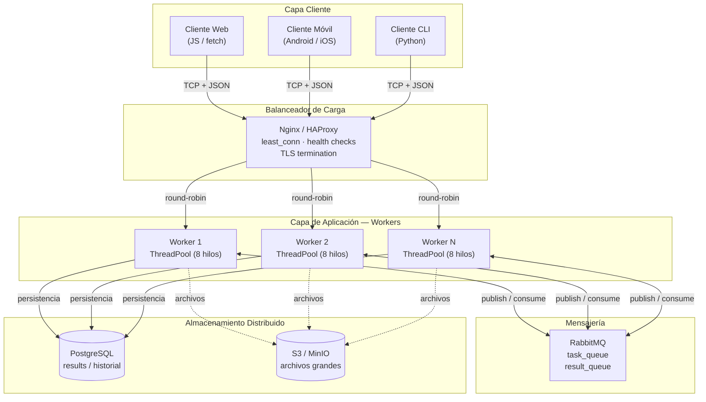

# PFO 3 — Sistema Distribuido Cliente-Servidor

Este repositorio contiene la resolución de la Práctica Formativa Obligatoria 3. El objetivo es transformar un sistema en una arquitectura distribuida utilizando sockets en Python.

## Diagrama de arquitectura

El siguiente diagrama muestra el diseño de la arquitectura distribuida propuesta, incluyendo clientes, balanceador de carga, workers, cola de mensajes y almacenamiento distribuido.



## Estructura del Código (Implementación en Python)

Para el entorno de prueba y ejecución provisto en este repositorio, se implementó el núcleo de la arquitectura:
- **Servidor (`server/`):** Recibe tareas vía sockets TCP, utiliza un `ThreadPool` (pool de 8 hilos) para procesar las tareas de forma concurrente y devuelve los resultados.
- **Cliente (`client/`):** Se conecta al servidor, envía tareas en formato JSON y espera (consulta) los resultados.

Se optó por utilizar el formato **JSON** para la comunicación sobre los sockets TCP. La elección de JSON se debe a que es un protocolo de texto liviano, fácilmente legible por humanos (lo que facilita el debugging) y nativamente soportado por la librería estándar de Python (`json`), evitando la necesidad de serializar datos en formatos binarios complejos. Cada mensaje se envía delimitado por un salto de línea (`\n`) para que el receptor sepa exactamente dónde termina una tarea y empieza la siguiente.

## Cómo ejecutar el proyecto

### 1. Levantar el servidor
Abrir una terminal en la raíz del proyecto y ejecutar:
```bash
py -m server.server --host 0.0.0.0 --port 5000 --workers 8
```
*El servidor quedará escuchando en el puerto 5000.*


### 2. Ejecutar el cliente (en otra terminal)
Abrir una **nueva** terminal y enviar tareas al servidor:

```bash
# Probar una suma
py -m client.client sum 2 3


# Probar una multiplicación
py -m client.client mul 4 5


# Simular una tarea pesada de 3 segundos
py -m client.client sleep 3

```
### 3. Ejecución

A continuación se muestran las capturas de pantalla que demuestran el correcto funcionamiento del sistema.

**1. Servidor levantado y esperando conexiones:**


**2. Cliente enviando una suma y recibiendo el resultado:**


**3. Cliente enviando una multiplicación y recibiendo el resultado:**


**3. Cliente simulando una tarea pesada (sleep 3):**
